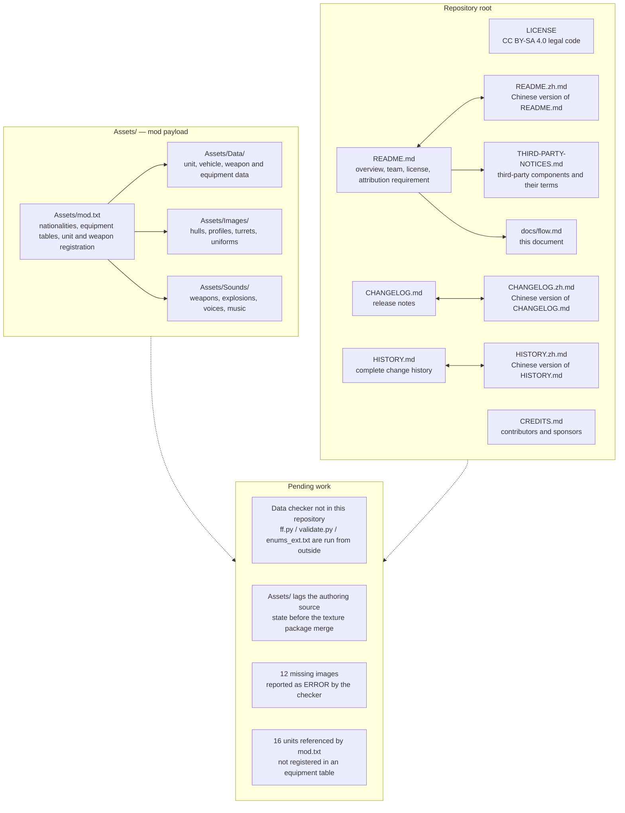

# Repository structure and data flow

## Repository files

Every document that exists in two languages is a pair of separate files: the plain name carries the English text and the `.zh.md` name carries the Chinese text, and the two files link to each other.

## Build artifacts

This repository has no build step and produces no build artifact. It is a data project: the files under `Assets/` are loaded by the game at runtime, and the documentation files at the root are read on GitHub.

The mod is published as a signed Android APK produced by a packaging toolchain kept outside this repository. That step copies the contents of `Assets/` to the root of a `Mod/` directory, embeds that directory into a base game APK under `assets/Mod/`, rewrites the manifest attributes, and signs the result with the project's release key. Because the game reads `mod.txt` from the root of the mod directory, the `Assets/` prefix must not be carried into the packaged `Mod/` directory.

## Pending work

The pending branch in the diagram above lists the items that are known and not yet done:

- **Data checker outside the repository** — the project's checker (`ff.py`, `validate.py`, `enums_ext.txt`) is not published here, so the data in `Assets/` cannot be validated from a clone of this repository alone.
- **`Assets/` lags the authoring source** — the imported state corresponds to the project as it stood before the texture package was merged.
- **12 missing images** — reported as `ERROR` by the checker: profile and hull images for `American-M113`, `American-M7A3 IFV`, `British-Jackal 2 MWMIK 148`, `British-MRAP` and `Israeli-Eitan AFV`.
- **16 unregistered units** — units referenced by `Assets/mod.txt` that no equipment table registers.
